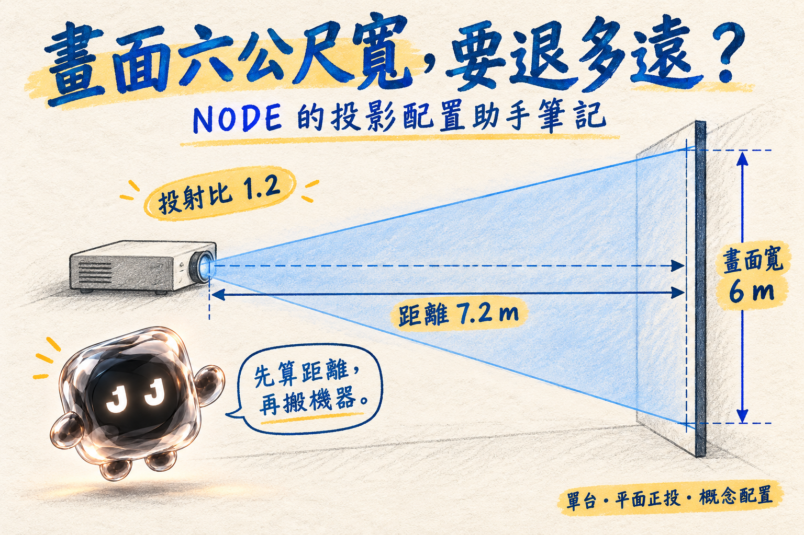
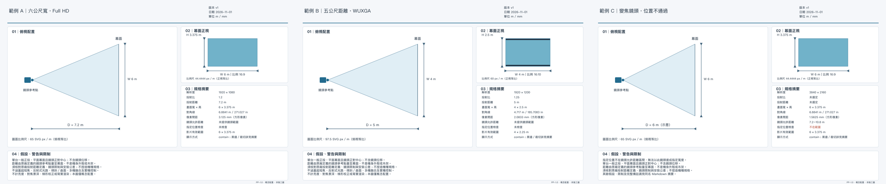

# 投影配置助手 projection-planner

獨立 Codex Skill：單台一般投影機，平面正對幕面的概念配置。使用自然語言描述需求，由 Codex 整理輸入後執行可測試的 Python 計算，輸出繁體中文 Markdown、JSON 與固定 SVG 圖面。與 Stage Lab 無相依、整合或功能關係。

[閱讀 NODE 圖文教學](article.md) · [下載完整 Skill ZIP](projection-planner.zip)



## 預覽與答案



| 範例 | 輸入 | 預期／驗證結果 | 檔案 |
|---|---|---|---|
| A | 寬6m、16:9、T=1.2、Full HD | D=7.2m、H=3.375m | [SVG](examples/A.svg) · [PNG](examples/A.png) · [摘要](examples/A.md) |
| B | D=5m、T=1.25、16:10、WUXGA；影片16:9 | W=4m、H=2.5m；有效4×2.25m，上下黑邊各0.125m | [SVG](examples/B.svg) · [PNG](examples/B.png) · [摘要](examples/B.md) |
| C | 寬6m、T=1.2–1.8、候選位置6m、4K UHD | 距離區間7.2–10.8m，6m不通過 | [SVG](examples/C.svg) · [PNG](examples/C.png) · [摘要](examples/C.md) |

完整完成範本是 `examples/A.svg`；空模板位於 `assets/templates/layout.svg`（含程式佔位符，須由腳本填入）。三組例子都是自製，沒有客戶資料。

## 格式、安裝與呼叫

2026-11-01 依 [OpenAI 官方 Build skills 文件](https://learn.chatgpt.com/docs/build-skills)核對：Skill 是包含 `SKILL.md` 的目錄，前置欄位包含 name、description；可附 scripts、references、assets 及 agents/openai.yaml。本套件採此結構。

手動安裝：下載或複製整個 `projection-planner` 資料夾至使用者 `~/.agents/skills/projection-planner/`；專案限定則放到該專案的 `.agents/skills/projection-planner/`。不可只複製 SKILL.md，必須保留相對路徑資源。

若此目錄就是倉庫根目錄，可在 macOS/Linux 終端機：

```sh
mkdir -p ~/.agents/skills
# 目標存在時先確認版本；不要直接覆蓋既有技能。
cp -R /path/to/projection-planner ~/.agents/skills/
```

Windows 可用檔案管理員複製到個人目錄下 `.agents/skills/projection-planner`。官方也支援 `$skill-installer` 從其他倉庫下載；本專案網址：https://github.com/januart1st0101/projection-planner。

確認：Codex 技能選單可找到「投影配置助手」，在對話輸入 `$projection-planner` 並提供下列範例。Codex 通常自動偵測新增技能；未出現時重新啟動。確認它實際執行 scripts/planner.py 並產生三種輸出，不只回答口算結果。未安裝也可請 Codex 直接讀本機此資料夾的 SKILL.md 測試。

倉庫網址：https://github.com/januart1st0101/projection-planner。

官方建議可重複分發的技能後續包成 plugin；本版先保留獨立資料夾。此專案提供獨立 Skill，未建立 plugin 或 MCP。

## 可複製的自然語言提問

```text
用投影配置助手算寬六公尺、16:9、投射比1.2，需要多遠？原生Full HD，專案「展演A」、版本v1。請附配置圖。
```

```text
使用 $projection-planner：距離500公分、投射比1.25、原生WUXGA 1920×1200，影片16:9，請等比適配並列黑邊，附SVG和摘要。
```

```text
使用 $projection-planner：畫面寬6000毫米、原生4K UHD、鏡頭投射比1.2到1.8，候選位置6公尺，檢查能不能達成，列距離區間並出圖。
```

自訂例：寬3m、T=1.5、比例2:1、原生2000×1000；請勿把影片比例當作原生解析度比例。

## 本機執行、依賴與測試

核心只需 **Python 3.10+ 標準函式庫**，沒有 API、金鑰、付費服務或額外 pip 依賴。SVG 使用本機中文字型 fallback，不包含字型檔；缺字時安裝合法的 CJK 字型。

```sh
python3 scripts/planner.py examples/A.input.json --output output/A
python3 -m unittest discover -s tests -v
```

輸出 output/A.svg、A.md、A.json。正規化輸入格式與公式見 [計算說明](references/calculation.md)，固定規範見 [視覺規則](assets/templates/visual-rules.md)。CLI 接收 JSON；自然語言理解由 Skill/Codex 負責。已有輸出會拒絕覆寫，請改檔名或版本。輸出日期須明確寫入 JSON；不偷偷讀系統日期，因此相同輸入可重現。

可選視覺 QA：`npm install --no-save sharp` 後執行 `node tests/render_qa.cjs`，會渲染三組範例並檢查圖上文字界限／碰撞。此依賴只用於開發驗證，不是 Skill 運作所需。也可用瀏覽器直接開 examples/*.svg 檢查。不同字型的像素外觀可不同，固定的是版型與 SVG 幾何。

測試結果與實際渲染記錄見 [驗證報告](tests/RESULTS.md)。

## 限制

只做一般單機平面正投。距離以原廠指定鏡頭參考點至幕面；須核對機種允許的實際投射／對焦距離與安裝公差。無機種資料時只報幾何概念值，不捏造品牌規格。

不計超短焦、反射式、傾斜／曲面、鏡頭位移、梯形校正、多機融合、亮度／流明推薦、對焦景深、實機控制或寫實渲染。第一版保守支援比例0.1–10、T=0.4–10；界線不是物理定律，特殊系統需另行規劃。原生解析度假定方形像素。

影片與原生比例不同，預設等比適配並列黑邊／有效畫面；裁切、拉伸需明確選擇。像素間距是原生全幅間距，未模擬整數像素取整。圖形各視圖等比縮放，投影機圖示僅符號。長文字依固定容量縮略，完整內容移至 Markdown 附件，外部區塊位置保持不變。

## 授權

本次發布未指定開源授權條款。字型與渲染工具保留各自授權，未打包進此套件。
