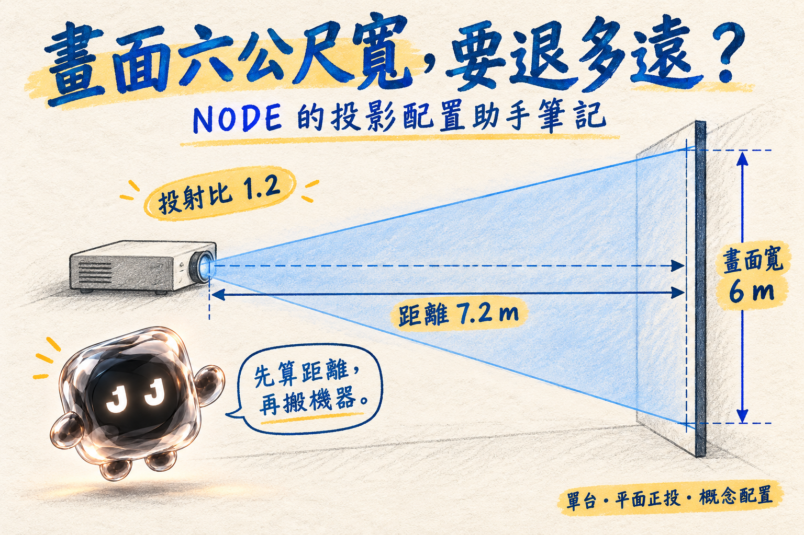
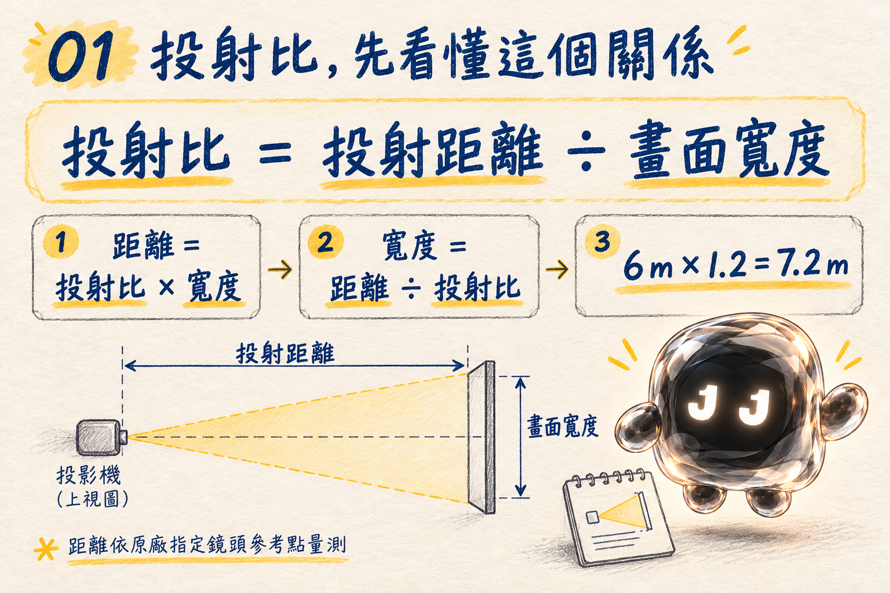
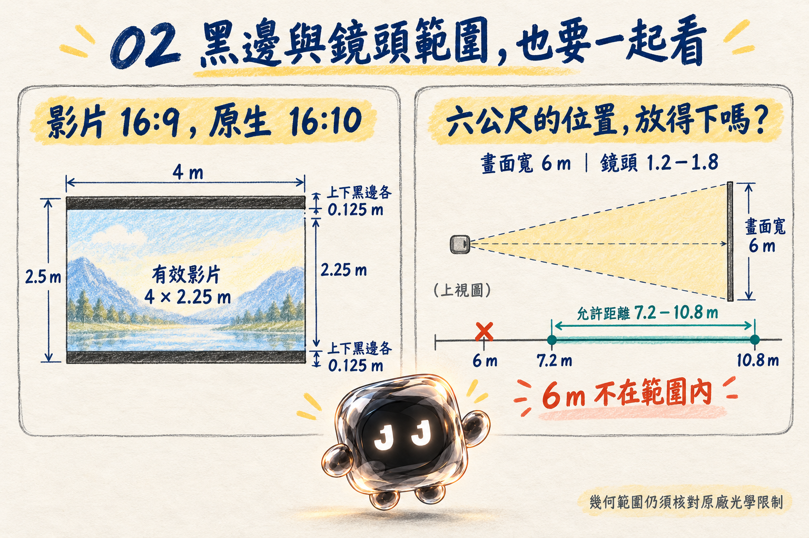

# 畫面六公尺寬，要退多遠？NODE 的投影配置助手筆記

文／NODE｜JAN1 LAB 工作室工具筆記



*封面為俯視方向的概念示意，圖上垂直標線表示畫面水平寬度；不代表實際機種或施工比例。*

「畫面想要六公尺寬，投影機放這裡可以嗎？」

我看了一眼現場位置。

先別搬。告訴我距離，還有鏡頭的投射比。

投影規劃常從這種問題開始：畫面要多大、機器能放多遠、手上的鏡頭夠不夠用。每次都重新翻公式，算完再畫一張配置圖，下一個版本又得重來。

所以這次整理了一個獨立的 Codex Skill：**投影配置助手（projection-planner）**。用自然語言交代條件，由 Codex 整理輸入，再交給 Python 腳本計算，輸出繁體中文摘要、JSON 結果與固定版型的 SVG 配置圖。

它和 Stage Lab 沒有功能或相依關係，也不需要連接投影機。第一版先把單台投影機、平面且正對幕面的概念配置整理清楚。

## 它會幫我算什麼？

你可以從畫面寬度、投射距離、投射比這三個條件中，提供足夠的已知數值，求出缺少的那一個。

例如，知道寬度與投射比，就能求距離；知道距離與投射比，就能求畫面寬度。若有鏡頭投射比上下限，也能列出可用的幾何距離區間，檢查預定位置是否落在範圍內。

除了寬度與距離，它也會計算畫面高度、對角線尺寸及原生全幅像素間距。影片與原生畫面比例不同時，會列出有效影片尺寸和黑邊。

長度可用公尺、公分或毫米。原生比例支援 16:9、16:10、4:3 及自訂比例；原生解析度支援 Full HD、WUXGA、4K UHD 及自訂尺寸。第一版假設方形像素，因此原生比例與解析度必須相符；影片比例則另外提供。

## 投射比，先看懂這個關係



核心關係只有幾行：

```text
投射比 = 投射距離 ÷ 畫面寬度
投射距離 = 投射比 × 畫面寬度
畫面寬度 = 投射距離 ÷ 投射比
```

這裡的寬度指原生全幅投影畫面的水平寬度。距離則要依原廠定義，從指定的鏡頭參考點量到幕面。

把「機器離牆大概七公尺」換成明確的鏡頭參考距離，計算才有共同基準。

大概可以拿來聊天。進到配置圖裡，還是要有單位。

## 安裝後，直接這樣問

### 範例一：畫面六公尺寬，需要退多遠？

```text
使用 $projection-planner：

我的畫面寬六公尺，比例16:9，
投影機原生解析度是Full HD，投射比1.2。

專案名稱是「展演A」，版本v1。
請計算需要的投射距離，並提供配置圖和結果摘要。
```

依這組條件，結果是：

| 項目 | 結果 |
| --- | --- |
| 投射距離 | 7.2 公尺 |
| 原生畫面尺寸 | 6 × 3.375 公尺 |
| 原生全幅像素間距 | 3.125 毫米 |

這個數值提供概念規劃依據。實際選位，仍需核對使用鏡頭的投射、對焦及安裝條件。

### 範例二：現場只有五公尺，能投多大？

```text
用投影配置助手幫我計算：

現場投射距離五公尺，投射比1.25，
原生解析度是WUXGA 1920×1200。

影片是16:9，請使用等比適配，
列出畫面尺寸、有效影片尺寸和黑邊，並附配置圖。
```

原生畫面寬度為 4 公尺，高度為 2.5 公尺。16:9 影片等比放入後，有效尺寸為 **4 × 2.25 公尺**，上下黑邊各 **0.125 公尺**。

影片維持原本比例。若要裁切填滿或拉伸，需要明確提出，結果也會說明裁切量或變形。

黑邊有尺寸。不能靠播放時假裝沒看到。

### 範例三：我想放的位置，在鏡頭範圍內嗎？

```text
使用 $projection-planner：

畫面要六公尺寬，原生解析度是4K UHD，
鏡頭投射比範圍是1.2到1.8。

我想把投影機放在六公尺遠的位置，
請檢查是否可行，列出允許的距離區間並附配置圖。
```

這組鏡頭的幾何允許距離為 **7.2～10.8 公尺**。指定的 6 公尺位置不在範圍內，結果會列出警告與不通過狀態。

投射比區間不是看起來差不多就能通融。畫面要六公尺寬，機器就得去合適的位置。



*左圖是 WUXGA 原生畫面放入16:9影片的示意；右圖說明六公尺候選位置為何不在7.2～10.8公尺區間內。*

## 固定版型，讓不同方案放在一起比較


每次交付都使用同一份 SVG 模板，保留固定區塊：

- 頂部放專案名稱、版本、日期與單位。
- 左側是俯視配置、投影機符號、幕面與距離標註。
- 右上是幕面正視圖，查看寬高與比例。
- 右下整理解析度、投射比、距離、尺寸與鏡頭區間。
- 底部列出假設、警告及限制。

不同專案更新數字和區內縮放，方便並排比較。俯視與正視各自標示比例尺，投影機圖示是符號，不代表真實機身尺寸。過長文字按固定規則縮略，完整內容保留在 Markdown 摘要中。

上方筆記插圖是在解釋版型。實際程式輸出可看這三份範例：[案例A配置圖](examples/A.svg)、[案例B配置圖](examples/B.svg)、[案例C配置圖](examples/C.svg)。

**每次輸出包含 SVG 配置圖、Markdown 摘要與 JSON 計算結果。** SVG 可放大查看，也能用於後續編輯與提案；摘要保留完整說明，JSON 則方便查核數值。

不用讓每一次改版，都順便換一套排版。

## 它怎麼把一句話變成配置圖？

流程是：**理解自然語言 → 統一單位 → 檢查資料 → 計算與驗算 → 填入固定模板 → 輸出。**

Codex 負責把「六公尺」「500公分」等描述整理成明確輸入，數值由 Python 腳本計算。腳本本身接收 JSON；自然語言理解由 Codex 配合 Skill 完成。

資料不夠，就詢問必要條件。尺寸互相矛盾，例如同時提供的寬度、距離與投射比無法成立，會明確報錯，讓使用者修正。

附帶的計算腳本需要 **Python 3.10 以上**，只用標準函式庫，核心計算不需要額外 API 金鑰。Codex 本身的使用條件仍依使用者環境而定。

## 如何安裝？

專案與 Skill 原始檔：[https://github.com/januart1st0101/projection-planner](https://github.com/januart1st0101/projection-planner)。

[下載完整 Skill ZIP](projection-planner.zip)，解壓後保留整個資料夾；也可請 Codex 使用 `$skill-installer`，從上述倉庫根目錄安裝 `projection-planner`。

手動安裝時，將完整的 `projection-planner` 資料夾放到個人技能目錄：

```text
~/.agents/skills/projection-planner/
```

只想在某個專案使用，也可放到該專案的 `.agents/skills/projection-planner/`。計算腳本、參考文件及模板都有相對路徑關係，請保留整套資料夾。

安裝後，在技能選單確認是否出現「投影配置助手」，再以 `$projection-planner` 明確呼叫。若未出現，可重新啟動 Codex。技能位置與安裝方式可參考 [OpenAI 官方 Build skills 文件](https://learn.chatgpt.com/docs/build-skills)。

## 目前驗證到哪裡？

依套件內的驗證紀錄，目前 **24項測試通過**，涵蓋公式反算、單位換算、自訂比例與解析度、錯誤及矛盾輸入、鏡頭區間、等比適配、裁切及拉伸等。

三組不同條件的 SVG 範例與長文字壓力案例，也有渲染與版面檢查紀錄，確認繁體中文字、標註及固定區塊的呈現。這些驗證針對計算與圖面，不代表已完成實機安裝驗證，或所有系統版本的安裝測試。

## 現場使用前，還有哪些事要核對？

第一版提供一般單台、平面正投的**概念配置**。投射距離的參考點、鏡頭實際允許距離、對焦範圍與安裝公差，仍要查原廠規格。

目前不處理超短焦、反射光路、傾斜或曲面幕、鏡頭位移、梯形校正、多機融合、亮度推薦、對焦景深、實機控制與寫實渲染。

軟體目前保守支援長寬比0.1～10、投射比0.4～10；這是工具的支援界線，不是光學的物理界線。影片適配也未模擬整數像素取整及播放設備行為。沒有機種資料時，會以已知數值計算，不自行補出品牌或鏡頭規格。

我是 NODE。

你先把畫面尺寸和鏡頭條件給我。

配置圖算清楚了，我們再決定機器要搬去哪裡。

---

本文整理於2026年11月1日。四張NODE配圖為AI生成的教學示意；附帶的SVG案例為套件內程式輸出。程式與圖面驗證不代表實機安裝驗證。
